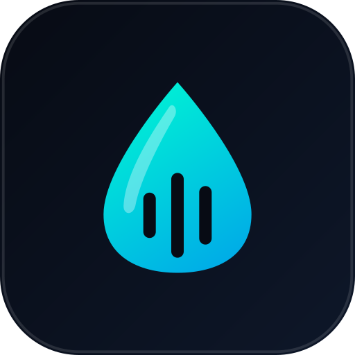
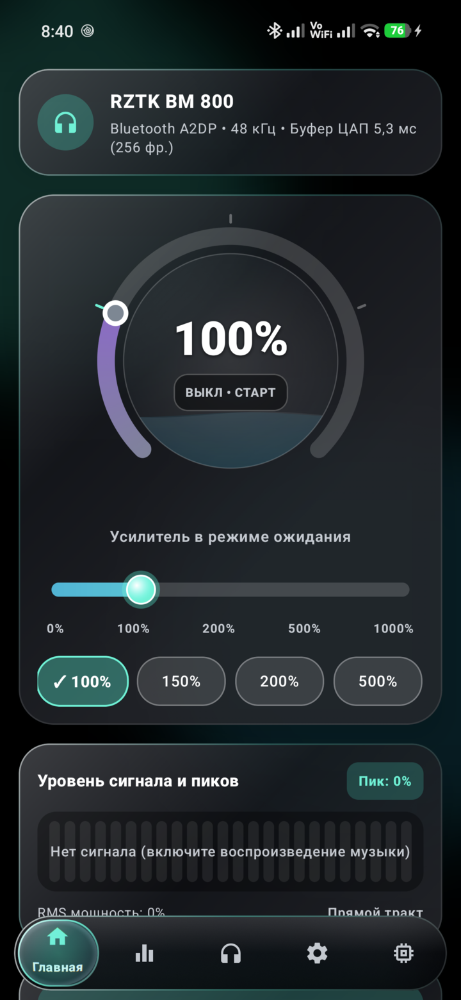
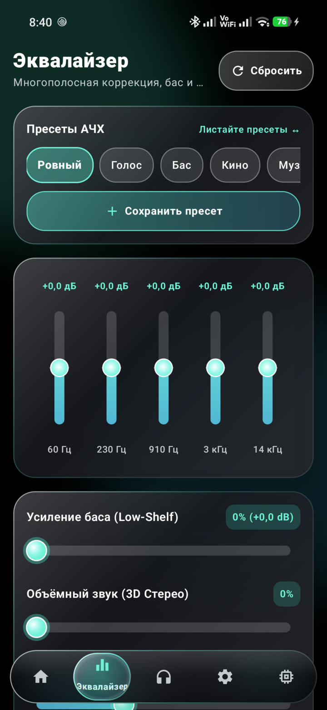
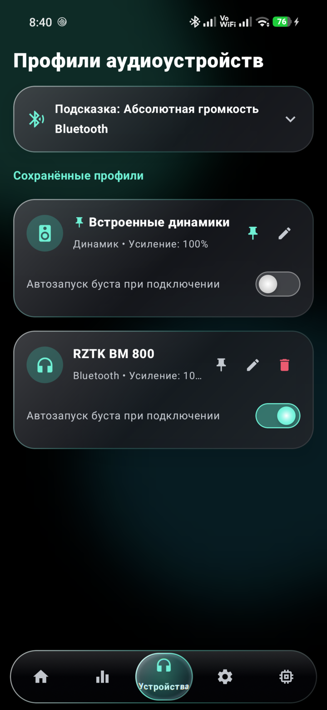
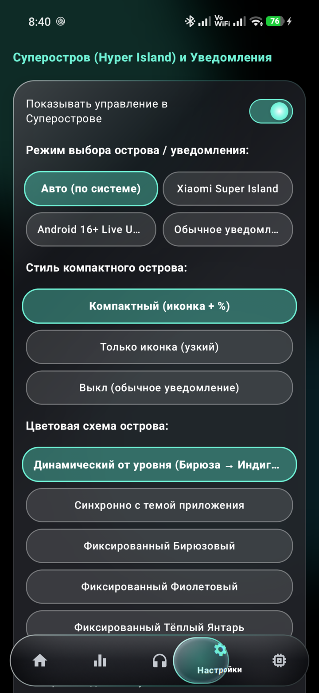
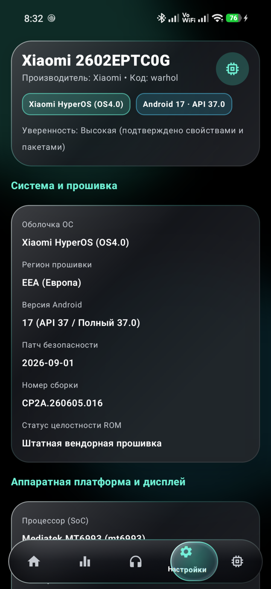

<div align="center">
  
  <h1>HyperBoost</h1>
  <p>Volume booster and equalizer for Android with Xiaomi Hyper Island and Liquid Glass UI</p>
  <p>
    <a href="https://github.com/MrQuster/HyperBoost/releases/latest"></a>
    <a href="LICENSE"></a>
    <a href="https://github.com/MrQuster/HyperBoost/actions/workflows/ci.yml"></a>
    <a href="app/build.gradle.kts"></a>
  </p>
  <p>
    <b>English</b> •
    <a href="README.ru.md">Русский</a> •
    <a href="https://github.com/MrQuster/HyperBoost/releases/latest">Download APK</a> •
    <a href="https://github.com/MrQuster/HyperBoost/issues">Report Issue</a>
  </p>
</div>

---

HyperBoost is an open-source Android utility (Android 10+, API 29+) that increases audio volume above the standard 100% cap on phone speakers, Bluetooth headphones, external speakers, and USB DACs. It features a translucent Liquid Glass interface, 5 distinct screens, and integration with Xiaomi Super Island (`miui.focus.param`) and Android 16+ Live Updates.

<!-- TODO: add a short personal note here if you want, e.g., why you started building HyperBoost or which headphones/speakers you use it with -->

## Screenshots

| Home | Equalizer | Devices | Settings | System |
| :---: | :---: | :---: | :---: | :---: |
|  |  |  |  |  |

---

## How It Works

Android handles audio effects differently across device manufacturers and OS skins. HyperBoost includes two independent audio engines:

1. **Soft Mode (Session 0):** Attaches Android's system `LoudnessEnhancer` and 6-band `DynamicsProcessing` stage directly to the global audio mixer (`sessionId = 0`). It introduces zero audio latency and functions across all players, including DRM-protected streams.
2. **Audio Capture Mode (PCM DSP):** Captures the audio stream via `MediaProjection` and `AudioPlaybackCapture`, processing 48 kHz stereo samples through a 64-bit digital multiplier, a 95 Hz Biquad low-shelf bass filter, a Mid/Side stereo widener, and a continuous soft-knee (`tanh`) limiter. This engine bypasses vendor mixer constraints on devices where Session 0 is locked or attenuated.

---

## Device Compatibility

HyperBoost is developed specifically for Android. On startup, `DeviceProfileDetector` evaluates system properties and packages to select the best available audio and island presentation strategy:

| Device / OS Skin | Verification Status | Features & Notes |
| :--- | :--- | :--- |
| **Xiaomi 17T Pro (HyperOS 4, Android 17 / API 37)** | Tested on physical device | Full support: both audio engines, Super Island (`miui.focus.param`) with `−10%` / `+10%` steps, battery and autostart shortcuts. |
| **Other Xiaomi / Redmi / POCO (HyperOS 1–3, MIUI 14)** | Expected to work (needs verification) | Uses identical focus notification structures and Xiaomi intent endpoints. |
| **Android 16+ devices (Pixel, Nothing, Motorola)** | Expected to work (needs verification) | Promoted ongoing Live Updates and standard AOSP background execution policies. |
| **Samsung One UI, OnePlus, OPPO, realme, vivo, Honor** | Expected to work (needs verification) | Standard media notification with `−10%` / `+10%` controls and vendor background guides. If Dolby Atmos or SoundAlive limits Session 0 peaks, use Audio Capture mode. |

If you test HyperBoost on your phone, go to the **System** tab, tap **Copy Report**, and submit it in [Issues](https://github.com/MrQuster/HyperBoost/issues) to help keep this table up to date.

---

## Features

- **Uncapped volume scale:** Default scale ranges from 0% to 1000% (with clear 100%, 200%, 500% markers), and an optional Unlimited Mode unlocks up to 10,000% for very quiet media.
- **Fixed −10% and +10% controls:** Xiaomi Super Island, shade notifications, Glance home widget, and Quick Settings tile provide quick `−10%`, `+10%`, and `On/Off` controls.
- **Working bass, surround, and balance controls:** The app inspects whether hardware `BassBoost` and `Virtualizer` are available. If not, it routes bass and spatial balance through a 6-band `DynamicsProcessing.PreEq` stage or the software Biquad/Mid-Side DSP.
- **Per-output memory:** Automatically stores and restores independent volume levels for internal speakers, each paired Bluetooth device, wired headphones, and USB DACs.
- **Zero internet access:** HyperBoost does not request or include the `android.permission.INTERNET` permission.

---

## Limitations

- **Capture policy (DRM):** Apps with `ALLOW_CAPTURE_BY_NONE` (voice calls, banking clients, certain DRM-protected video streams) cannot be recorded by Android's `AudioPlaybackCapture`. Use **Soft Mode (Session 0)** for those applications.
- **HyperOS Super Island whitelist:** Some global HyperOS builds restrict custom island views to whitelisted system packages. HyperBoost detects this and falls back to a persistent notification with the same `−10%` and `+10%` actions.

---

## Installation

1. Download the latest `HyperBoost-vX.Y.Z.apk` from [GitHub Releases](https://github.com/MrQuster/HyperBoost/releases/latest).
2. Open the file on your device and confirm installation. If Google Play Protect shows an "Unknown developer" alert, tap **More details** &rarr; **Install anyway**.
3. On Xiaomi / HyperOS devices:
   - In HyperBoost open **Settings** &rarr; **Notification Settings** and enable **Focus Notifications / Super Island**.
   - In background settings set battery saver to **No restrictions** and allow **Autostart**.

To verify package integrity before installing on Linux:
```bash
sha256sum -c HyperBoost-v1.4.0.apk.sha256
```

---

## Building from Source

Requires JDK 17 and Android SDK (API 35):

```bash
# Clone the repository
git clone https://github.com/MrQuster/HyperBoost.git
cd HyperBoost

# Run unit tests and assemble Debug APK
./gradlew clean test lintDebug assembleDebug

# Assemble Release APK with R8 (output in app/build/outputs/apk/release/)
./gradlew assembleRelease -PversionName="1.4.0"
```

---

## FAQ

**Why is there no boost effect in some apps?**  
Certain apps (e.g. streaming with DRM protection or voice calls) block audio capture. Switch to **Soft Mode (Session 0)** on the home screen.

**How do I turn on Xiaomi Super Island?**  
Go to phone **Settings** &rarr; **Notifications & status bar** &rarr; enable **Focus notifications** for HyperBoost. Inside the app, tap the island self-test in the **System** tab to confirm.

**How do I disable Bluetooth Absolute Volume?**  
If your Bluetooth headphones reach maximum volume too early, open **Developer Options** in Android settings and toggle **Disable Absolute Volume**.

---

## Important Notice

High volume amplification can overdrive speaker hardware or cause hearing fatigue over prolonged exposure. Use sensible listening levels and enable the soft-knee (`tanh`) limiter in Settings if you experience distortion.

---

## License & Author

- License: [MIT](LICENSE)
- Author: [MrQuster](https://github.com/MrQuster)
